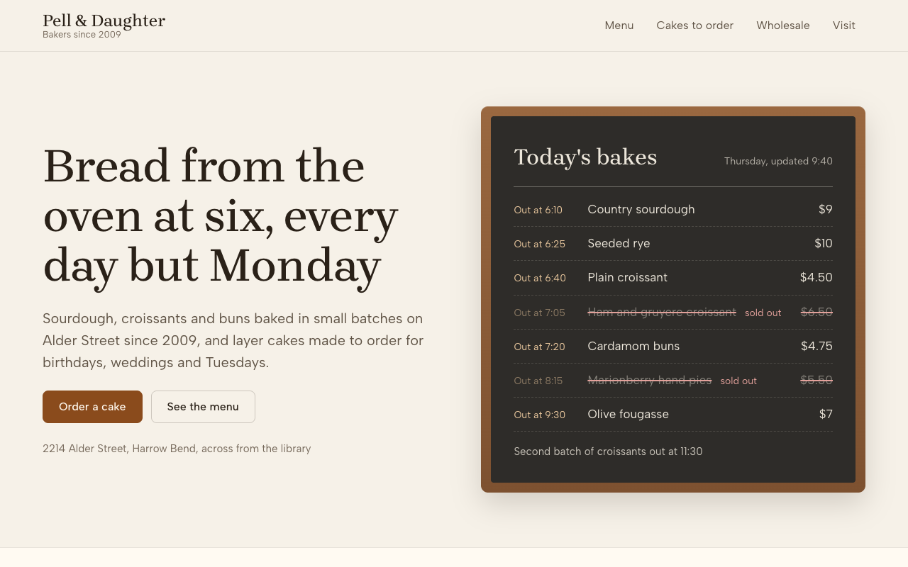

# Pell & Daughter: Astro bakery website template

A neighborhood bakery website with today's bakes on a slate board, the full menu with allergens, cakes to order with an order form, wholesale prices and terms, and hours. Static, fast, and no server needed.



[](https://console.cloudzyro.com/new?repo=https://github.com/Cloudzyro/template-bakery)

## What's included

- Home page with today's bakes on a slate board (when each batch came out of the oven, prices, and sold-out bakes struck through), cakes to order, the bakery's story, wholesale terms and hours
- Menu page (bread, viennoiserie and buns, cakes by the slice, coffee and tea) with prices, allergen marks and a key
- Cakes to order page with six cakes drawn in SVG, sizes and prices, and an order form: flavor, size, pickup date and time, writing on the cake with a letter count, and notes. The earliest pickup date is set from your lead time (72 hours by default) and checked before sending
- Wholesale page with delivery days, minimums, payment terms, wholesale prices and an inquiry form
- Visit page with hours (today highlighted), a drawn street map, address, phone and a directions link
- Bakery structured data (schema.org) with opening hours, Open Graph tags, sitemap, robots.txt, favicon and a 404 page
- Responsive down to 360px, keyboard friendly, reduced motion respected
- Cake drawings and the map are SVG drawn in code, so there are no photos to license

## Run it locally

```bash
pnpm install
pnpm dev        # http://localhost:4321
pnpm build      # static site in dist/
pnpm preview
```

## Make it yours

- **Content:** everything is in `src/data/site.ts`: the bakery's name, address, phone, emails, hours, the menu, cakes, sizes, order rules, wholesale prices and terms, and the story.
- **Today's bakes:** edit `todaysBakes` in `src/data/site.ts` (name, the time each batch came out, price, and `soldOut: true` to strike one through), then rebuild. Deploying from GitHub means an edit on your phone in GitHub's editor puts the new board online.
- **Forms:** set `PUBLIC_FORM_ENDPOINT` to a form endpoint from Formspree, Basin, a Supabase function or similar. The cake form sends `name`, `email`, `phone`, `flavor`, `size`, `pickup_date`, `pickup_time`, `message_on_cake` and `notes`; the wholesale form sends `name`, `business`, `email`, `phone`, `address` and `order`. With no endpoint set, each form shows a short note and opens the visitor's email app (cake orders to `email`, wholesale to `wholesaleEmail` in `src/data/site.ts`).
- **Lead time:** `cakeOrders.leadHours` in `src/data/site.ts` sets how far ahead cakes must be ordered.
- **Site address:** set `SITE_URL` (for example `https://www.pellanddaughter.com`) so the sitemap, canonical links and social previews use your domain.
- **Colors and fonts:** colors are CSS variables at the top of `src/styles/global.css`. Fonts are Brygada 1918 for headlines and Albert Sans for everything else, self-hosted with Fontsource and imported in `src/layouts/Base.astro`.
- **Pictures:** each cake has an `art` (layer, bundt, tart or loaf) and three colors, drawn by `src/components/CakeArt.astro`. To use photos instead, swap that component for an `` and put your files in `public/`.
- **Social preview image:** replace `public/og.png` (1200 x 630).

Environment variables are read at build time. Locally, put them in `.env` (see `.env.example`):

```bash
PUBLIC_FORM_ENDPOINT=https://formspree.io/f/your-id
SITE_URL=https://www.pellanddaughter.com
```

## Deploy

Click the Deploy button above, or push your own copy to GitHub and connect it in the Cloudzyro console. Add the environment variables in your site's settings. The build command is `pnpm build` and the output folder is `dist/`, a plain static site.

## Stack

- Astro 7 (static output)
- @astrojs/sitemap
- Fontsource (Brygada 1918, Albert Sans)
- TypeScript, plain CSS

MIT licensed. See [LICENSE](./LICENSE).
